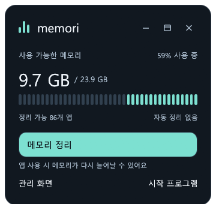

<p align="center"></p>
<h1 align="center">Memori</h1>
<p align="center">A small Windows widget for RAM usage and login startup apps.</p>
<p align="center">Windows 10/11 · x64 · Rust · MIT</p>
<p align="center"><a href="https://github.com/Alfex4936/windows-memory-optimizer/releases/latest">Download the latest release</a> · <a href="README.md">한국어</a></p>

## Get started

Download the Windows x64 ZIP from [Releases](https://github.com/Alfex4936/windows-memory-optimizer/releases/latest), extract it to a permanent folder, and run `memori.exe`. There is no installer or license key.

| Compact | Expanded |
|:---:|:---:|
|  |  |

The interface is in Korean. The compact widget shows RAM usage, cleanup, and expand controls. The expanded widget opens memory and startup management. Drag the header to move it; position, always-on-top state, and the last widget mode are remembered.

## Features

- Live physical/commit memory readings and per-process working sets.
- Sortable name, PID, working-set, and status columns with process selection.
- Reversible current-user Run and Startup-folder management, status filters, and command details.
- Optional launch at Windows login, configured from the startup page.
- Local operation without network requests, telemetry, ads, or a background service.

## What cleanup does

Memori uses Windows [`EmptyWorkingSet`](https://learn.microsoft.com/en-us/windows/win32/api/psapi/nf-psapi-emptyworkingset) to reduce eligible applications' resident working sets. It does not terminate applications or delete their data.

The effect is temporary. Pages return to RAM when used again, and an application's next response may be slower. Reported savings are observed working-set deltas, not guaranteed system-wide free RAM or a permanent performance improvement. Cleanup is manual.

Only supported processes owned by the current user in the current session are eligible. Windows components, known system/security processes, the current or last observed foreground process, Memori itself, and processes below 16 MB are excluded. Ownership, session, and process creation time are checked again before trimming.

## Startup boundaries

Current-user Run entries and Startup-folder files can be disabled with originals preserved, then restored. Machine-wide entries are read-only. Windows-disabled entries, uncertain states, and packaged apps route to Windows settings. Tasks, services, drivers, RunOnce, and policy-based startup entries are outside the app's management scope.

Restore any saved entries you still need before removing Memori. Existing conflicting entries are not overwritten. Changes apply at the next login. The [Korean usage guide](docs/usage.md) documents backup locations, startup registration, and command-line options.

## Build

Use Windows x64 with Rust stable and MSVC C++ build tools. Packaging with `build.ps1` also uses Python 3 (standard library only):

```powershell
cargo run
.\build.ps1
```

`build.ps1` checks formatting, Clippy, tests, and the locked release build, then creates `dist\Memori`, a versioned ZIP, and `SHA256SUMS.txt`. Close a running packaged copy before replacing it. Windows CI runs the same script and uploads the ZIP and checksums.

Tests use disposable registry keys, temporary files, and a test-owned child process; they do not modify real startup entries.

## License

[MIT](LICENSE). Dependency licenses are included in the release package's `THIRD_PARTY_NOTICES.txt`.
