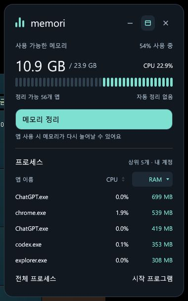

<p align="center">
  
</p>

<h1 align="center">Memori</h1>

<p align="center">바탕화면에서 가볍게 확인하는 RAM 사용량과 시작 프로그램.</p>
<p align="center">Windows 10/11 · x64 · Rust · MIT</p>

<p align="center">
  <a href="https://github.com/Alfex4936/windows-memory-optimizer/releases/latest">최신 버전 다운로드</a> ·
  <a href="docs/usage.md">사용 가이드</a> ·
  <a href="README.en.md">English</a>
</p>

<p align="center">
  <a href="https://github.com/Alfex4936/windows-memory-optimizer/actions/workflows/ci.yml"></a>
</p>

## 다운로드와 실행

1. [Releases](https://github.com/Alfex4936/windows-memory-optimizer/releases/latest)에서 Windows x64 ZIP을 받습니다.
2. 계속 사용할 폴더에 압축을 풀고 `memori.exe`를 실행합니다.
3. 필요하면 **시작 프로그램 → Windows 로그인 시 Memori 위젯 자동 실행**을 켭니다.

설치 프로그램이나 라이선스 키가 필요하지 않습니다. 현재 계정의 지원되는 항목은 관리자 권한 없이 관리합니다.

| 컴팩트 모드 | 펼친 위젯 |
|:---:|:---:|
|  |  |

## 필요한 기능만

- **최적화** — 선택한 백그라운드 앱에 절전 우선 정책을 적용하거나 Windows 자동 관리로 전환합니다. 고정 드라이브 여유 공간을 확인하고 Windows 저장소 설정에서 정리할 항목을 검토합니다.
- **임시 파일 정리** — 현재 계정의 임시 폴더와 DirectX 셰이더 캐시를 파일 수 제한 없이 검사합니다. 진행 중 취소할 수 있으며, 결과에서 파일명·경로·분류로 찾아 선택한 파일만 정리합니다.
- **저장소 도구** — 휴지통의 항목 수와 용량을 확인하고, 휴지통 또는 Windows 드라이브 최적화를 엽니다.
- **바탕화면 위젯** — RAM 사용률·여유 메모리·전체 CPU 사용률과 프로세스 상위 5개의 CPU·RAM을 확인합니다. CPU·RAM 열을 눌러 순서를 바꾸고, 전체 목록으로 바로 이동합니다. 접기·펼치기, 이동, 항상 위에 표시를 지원합니다.
- **설정 기억** — 위치·표시 상태·마지막 위젯 모드를 저장합니다. 모니터 구성이 달라지면 화면 안으로 복원합니다.
- **앱별 사용량** — 이름·PID로 검색하고, 이름·PID·CPU·작업 집합·정리 상태로 정렬합니다. 개별 프로세스를 선택해 정리할 수도 있습니다.
- **시작 프로그램** — 켜짐·꺼짐·확인 필요 필터, 상태 배지, 스위치로 로그인 시작 항목을 관리합니다. 상세 패널에서 실행 명령과 관리 범위를 확인합니다.
- **로컬 실행** — 네트워크 요청, 광고, 분석 수집, 백그라운드 서비스가 없습니다. 앱을 닫으면 모니터링도 끝납니다.

## 메모리 정리는 어떻게 동작하나요?

Windows의 [`EmptyWorkingSet`](https://learn.microsoft.com/en-us/windows/win32/api/psapi/nf-psapi-emptyworkingset)을 사용해 앱의 RAM 상주 페이지를 작업 집합에서 줄입니다. 앱을 종료하거나 데이터를 삭제하지 않습니다.

효과는 일시적입니다. 앱이 해당 페이지를 다시 사용하면 RAM으로 돌아오며, 다음 반응이 잠깐 느려질 수 있습니다. 결과는 **관측한 작업 집합 감소량**이고, 시스템 전체 확보량이나 지속적인 성능 향상을 뜻하지 않습니다. 자동 정리는 없습니다.

정리 대상은 현재 사용자·현재 세션의 지원되는 앱입니다. Windows 구성 요소, 알려진 시스템·보안 프로세스, 현재 또는 마지막으로 관측한 전면 앱의 프로세스, Memori 자체와 16 MB 미만 프로세스는 제외합니다. 실행 직전 소유자·세션·생성 시각을 다시 확인합니다.

## 시작 프로그램의 관리 범위

| 항목 | 지원 |
|---|---|
| 현재 계정 `Run` 레지스트리 | 원본을 보관해 끄기·복원 |
| 현재 계정 시작 폴더 | 원본 파일을 보관 폴더로 옮겨 끄기·복원 |
| 모든 사용자 `Run` 64/32비트·공용 시작 폴더 | 읽기 전용, Windows 설정 연결 |
| Windows에서 꺼진 항목·해석할 수 없는 상태·패키지 앱 | Windows 설정에서 관리 |
| 예약 작업·서비스·드라이버·`RunOnce`·정책 기반 시작 항목 | 관리 대상에 포함하지 않음 |

복원 시 같은 이름의 다른 항목을 덮어쓰지 않습니다. 변경은 다음 로그인부터 적용됩니다. **앱을 삭제하기 전에 보관 중인 항목 중 필요한 것을 다시 켜 주세요.** 보관 위치와 수동 복원 원리는 [사용 가이드](docs/usage.md#시작-항목-보관과-복원)에 있습니다.

## 개발

Windows x64, Rust stable, MSVC C++ 빌드 도구가 필요합니다. `build.ps1`의 배포 패키지 생성에는 Python 3도 사용합니다(표준 라이브러리만 필요).

```powershell
git clone https://github.com/Alfex4936/windows-memory-optimizer.git
cd windows-memory-optimizer
cargo run
```

전체 검증과 포터블 패키지 생성:

```powershell
.\build.ps1
```

스크립트는 포맷·Clippy·테스트·release 빌드를 검증하고 `dist\Memori`, 버전별 ZIP, `SHA256SUMS.txt`를 만듭니다. 실행 중인 Memori를 닫은 뒤 패키지를 갱신하세요. CI도 Windows에서 같은 스크립트를 실행하고 ZIP과 체크섬을 보관합니다.

테스트는 실제 시작 프로그램을 수정하지 않습니다. 레지스트리와 파일 검증은 임시 위치에서, 메모리 정리는 테스트가 만든 자식 프로세스에서 실행합니다.

## 라이선스

[MIT](LICENSE). 의존 라이브러리의 라이선스는 각 원저작자에게 있으며, 배포 패키지의 `THIRD_PARTY_NOTICES.txt`에 포함됩니다.
